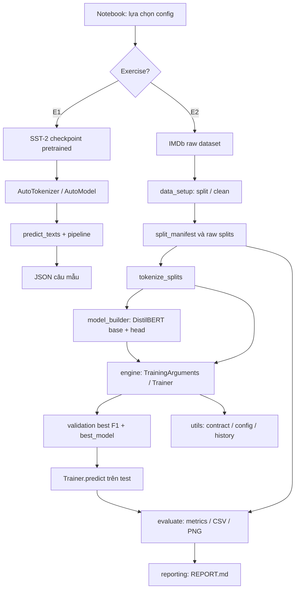
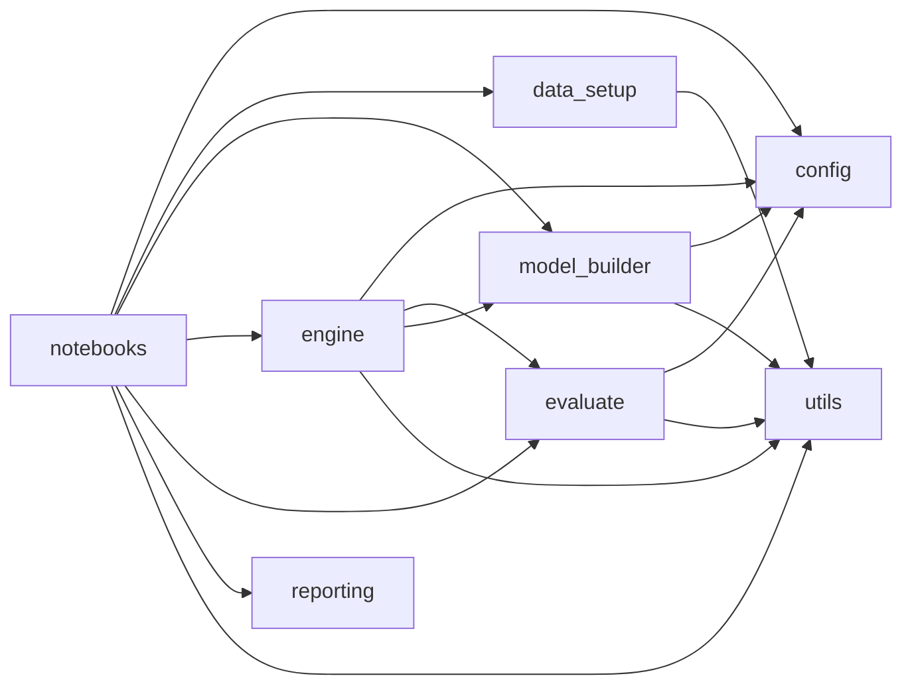
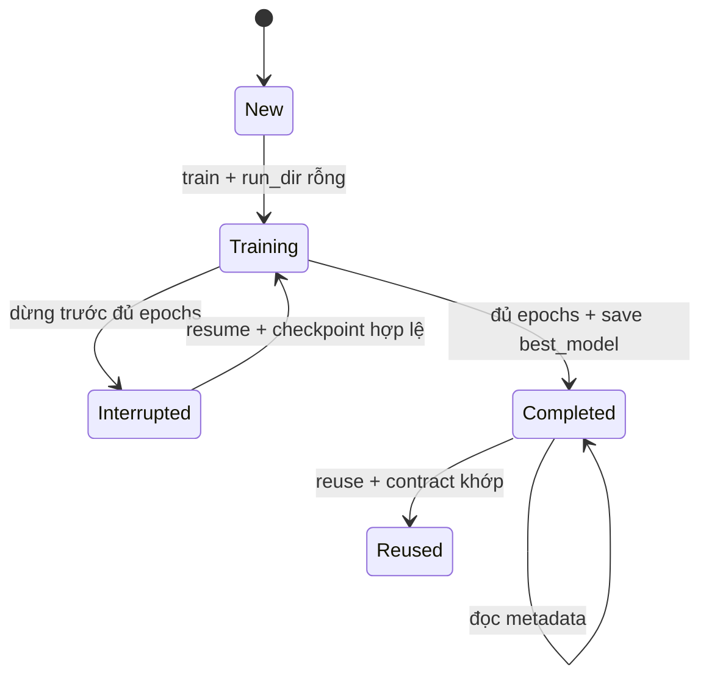

# THIẾT KẾ KIẾN TRÚC TỔNG THỂ VÀ HỢP ĐỒNG GIỮA CÁC MODULE

> **LAB3-ARCH-06 v3.0 — 13/11/2026.** Tài liệu giúp cô đọc nhanh một vòng: **thao tác notebook → module → I/O → artifacts → test**, không phải bản UML hình thức đã qua tool reverse engineering.

## 1. Bài toán thiết kế

Nếu để toàn bộ logic trong notebook, code khó unit test, mỗi lần restart kernel khó phát hiện dữ liệu bị lẫn, file output có thể bị ghi đè và báo cáo có nguy cơ nhập nhầm con số. Thiết kế hiện tại sử dụng notebook như **orchestrator hiển thị**, `going_modular/` cho logic có thể import, `tests/` cho kiểm thử offline, `reports/outputs` cho bằng chứng.

## 2. Sơ đồ luồng dữ liệu — E1 và E2 độc lập



**Nguyên tắc:** E1 chỉ infer, E2 train. Trong E2, raw test không vào `Trainer(train_dataset=...,eval_dataset=...)`; `eval_dataset` là validation. Test đến sau training để đánh giá cuối. `reporting` không tự predict hay train, chỉ nhận số liệu.

## 3. Sơ đồ phụ thuộc module



`utils` là lớp hỗ trợ nền, không import `engine` để tránh vòng phụ thuộc. Các công cụ third party gồm PyTorch, Transformers, Datasets, scikit-learn, NumPy, Pandas, Matplotlib.

## 4. Bảng trách nhiệm và giao diện chính

| Module | API chính (code thực) | Input | Output | Không chịu trách nhiệm |
|---|---|---|---|---|
| `config.py` | `RunConfig`, `for_profile`, `ID2LABEL` | profile/giá trị hợp lệ | immutable dataclass | Không tải dataset/model |
| `data_setup.py` | `load_imdb`, `prepare_raw_splits`, `split_manifest`, `tokenize_splits` | cfg, raw dataset, tokenizer | DatasetDict/manifest | Không tối ưu model |
| `model_builder.py` | `load_tokenizer`, `build_model`, `count_params`, `tokenizer_identity` | model ID/revision | tokenizer/model/metadata | Không gọi Trainer.train |
| `engine.py` | `make_training_args`, `run_experiment` | cfg, tokenized, manifest, paths, action | Trainer, history, run_dir | Không predict test/report |
| `evaluate.py` | `metrics_from_logits`, `compute_metrics`, `predict_texts`, `export_evaluation`, `plot_history` | logits/labels/model/test | dict, CSV/JSON/PNG | Không cập nhật weights |
| `utils.py` | `save_json`, `read_json`, `digest`, `seed_everything`, `environment_info`, `new_output_dir`, `check_action` | file/config/seed/action | path/hash/guards | Không định nghĩa model |
| `reporting.py` | `write_report` | cfg, metrics, history, completed | `REPORT.md` | Không tạo metrics ngẫu nhiên |

## 5. Hợp đồng cấu hình và validation

```python
RunConfig.for_profile('quick')  # 2000 train, 500 val, 1000 test; epochs 2, max_length 128
RunConfig.for_profile('full')   # all splits; epochs 3, max_length 256
```

`RunConfig` frozen nên không sửa thuộc tính trực tiếp. `__post_init__` kiểm run_id, số dương, LR, warmup_ratio, weight_decay, max_length. Nguồn duy nhất của tham số là `config.py`; notebook chỉ chọn profile/action. Không chép cấu hình khác vào tài liệu nếu lệch code.

## 6. Hợp đồng dữ liệu qua các lớp

| Công đoạn | Columns | Kích thước | Điều kiện bắt buộc |
|---|---|---|---|
| IMDb raw | `text`, `label` | 2 splits chuẩn train/test | Nhãn 0/1 |
| `prepare_raw_splits` | `text`, `label`, `sample_id` | train/validation/test | ID không lẫn, text đã clean |
| `tokenize_splits` | `input_ids`, `attention_mask`, `labels` | mỗi record len ≤ max_length | no padding at map stage |
| Collator | tensor IDs/mask/labels | `[B,L]`, `[B,L]`, `[B]` | dynamic padded batch |
| Model | logits và có thể loss | `[B,2]`, scalar | `num_labels=2` |
| `Trainer.predict` | logits, label_ids, metrics | `[N,2]`, `[N]` | thứ tự prediction khớp tokenized test |
| `export_evaluation` | raw test + predictions | JSON/CSV/PNG | so nhãn với raw test trước xuất |

### 6.1. Vì sao cả raw và tokenized được giữ?

Tokenized dataset mất trường `text` và `sample_id` để model không nhận cột dư; raw giữ text/ID cho phân tích lỗi. Nếu chỉ giữ tokenized, khi xuất `errors.csv` khó gắn dự đoán sai với câu review gốc. Vì vậy `raw_splits['test']` phải giữ thứ tự mẫu với `tokenized['test']`.

### 6.2. Hạn chế kiểm alignment hiện tại

`export_evaluation` xác nhận `prediction.label_ids` bằng `raw_test['label']`. Điều này phát hiện nhiều trường hợp lệch thứ tự nhưng **không đủ** nhận biết hai sample đổi chỗ nếu cùng nhãn. Việc bảo vệ mạnh hơn cần thêm `sample_id` theo từng prediction hoặc hash dữ liệu khi xuất. Đây là đề xuất kiểm thử `EVAL-P02`, không phải tính năng đã có.

## 7. Lifecycle của run và máy trạng thái



- `train`: `check_action` từ chối nếu run dir có nội dung.
- `resume`: yêu cầu config hợp đồng khớp, chưa `completed.json`, tìm checkpoint cuối và optimizer state; nếu không tìm thấy báo lỗi.
- `reuse`: yêu cầu completed/history và các file quan trọng trong `best_model`, nạp model từ local; không gọi train.
- Các action không cho phép chỉnh `cfg` cùng run_id rồi “lén” reuse, vì contract so sánh toàn bộ run_config + hash data manifest + tokenizer fingerprint.

## 8. Thiết kế file artifacts

```text
<artifact_root>/<run_id>/
  config.json                    # contract + versions + param summary
  split_manifest.json            # sizes/label dist/IDs/sha/overlap
  checkpoints/checkpoint-*/      # optimizer/scheduler/trainer states cho resume
  history.json                   # train/validation logs
  completed.json                 # trạng thái hoàn tất
  best_model/                    # weights, config, tokenizer cho reuse

<output_root>/<YYYY-MM-DD>/<run_id>/<timestamp>/
  test_metrics.json
  predictions.csv                # có thể bị gitignore
  errors.csv                     # có thể bị gitignore
  confusion_matrix.png
  history.png
  REPORT.md
```

Trong ZIP đầu vào có **metadata và một số hình/JSON nhưng không đủ checkpoint/best_model/CSV**. Sơ đồ trên là **hợp đồng của code khi run hoàn chỉnh**, không phải danh sách file chắc chắn hiện diện trong ZIP.

## 9. Vòng lỗi/ngoại lệ và phục hồi

| Tình huống | Phát hiện | Hành vi | Hướng xử lý đúng |
|---|---|---|---|
| `run_id='../x'` | RunConfig validation | ValueError | Đổi ID hợp lệ |
| val size quá lớn / không có đủ lớp | stratified_indices | ValueError | Sửa cfg hoặc dữ liệu đầu vào |
| Train lên run cũ | `check_action` | FileExistsError | Đổi run_id hoặc resume/reuse |
| Resume khi không có checkpoint | `get_last_checkpoint` | FileNotFoundError | Giữ logs, run mới nếu phải train lại |
| Resume sau completed | `check_action` | ValueError | Chọn reuse |
| Contract bị đổi | `check_action` | ValueError | Tạo run_id mới, không chỉnh JSON để lách |
| Chưa đủ epochs | `trainer.state.epoch` | InterruptedError, không completed | Resume từ checkpoint có đủ state |
| Logits có NaN/wrong shape | `metrics_from_logits` | ValueError | Kiểm model/tensor trước export |
| Labels và raw test khác | `export_evaluation` | ValueError | Sửa nguyên nhân alignment, không sửa tay labels |

## 10. Những gì có thể test và không thể test chỉ với unit tests

Có thể kiểm bằng tiny fixture: shape logits, scalar loss, all trainable, split ID/seed, metrics hand-calculated, atomic JSON, checkpoint interruption/resume/reuse, notebook Python syntax. Không thể suy từ tiny tests: semantic accuracy thực, tốc độ GPU thực, robustness cho review cực dài, fidelity giữa model revision về sau, khả năng chạy full trên máy của cô. Để chứng minh những mục sau cần run thật và báo cáo môi trường đầy đủ.

## 11. Cách đọc module specs theo vòng đời

1. `01_data.md`: input/manifest, cách chống leak;
2. `02_model.md`: checkpoint, tokenizer, head, tensor;
3. `03_engine.md`: Trainer, checkpoint, resume/reuse;
4. `04_utils.md`: seed/JSON/digest/lifecycle guard;
5. `05_evaluation_results.md`: metric/result integrity;
6. `tests/00_test_plan.md`: cách đưa các hợp đồng trên thành test cases;
7. `../analysts/requirements_traceability.md`: mapping FR ↔ các module.
